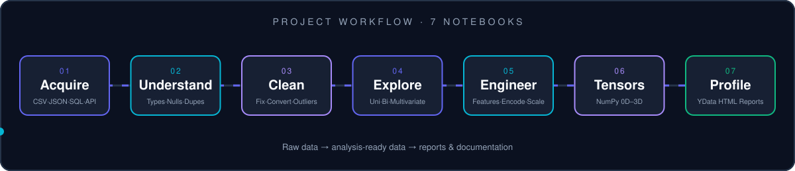
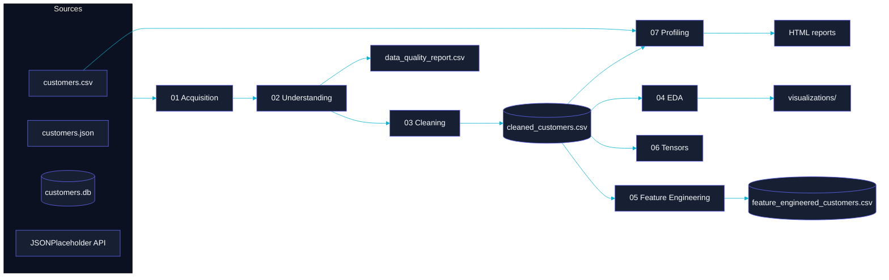
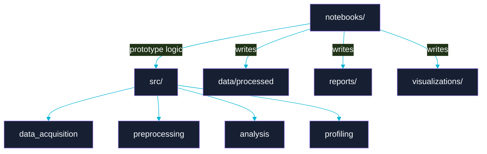

<div align="center">



<br/>


**A Python data-analyst project that takes customer data from raw acquisition to analysis-ready, profiled output.**

[Overview](#-project-overview) · [Features](#-key-features) · [Architecture](#-project-architecture) · [Dataset](#-dataset-documentation) · [Setup](#-installation--setup) · [Status](#-project-status--audit)

</div>


> [!NOTE]
> **Documentation integrity.** This README documents what has been designed and reported for the project. Items that have **not** yet been confirmed by executing the notebooks (charts, screenshots, numerical findings, generated reports) are explicitly marked **Pending verification** instead of being filled with assumed results. See [Project Status & Audit](#-project-status--audit).

---

## 📌 Project Overview

**Data Profiler – Data Preprocessing and Feature Engineering** is a practical, notebook-driven Python project. It shows how raw data is **acquired**, **understood**, **cleaned**, **explored**, **transformed** and **profiled** before analysis or modelling.

| | |
|---|---|
| **Project type** | Data Analyst practical assignment (Python / Data Science) |
| **Author** | Tej Patel |
| **Repository** | `data-profiler-data-preprocessing` |
| **Main folder** | `Data-Profiler/` |
| **Environment** | VS Code · Python · Jupyter Notebook · Git · GitHub |
| **Main dataset** | E-Commerce Customer Insights and Churn Dataset (`customers.csv`) |

### The problem

Raw customer data rarely arrives ready for analysis. It may come from several sources, contain inconsistent types, text or dates, and hide quality problems such as missing values, duplicates and outliers. Analysis built on it without inspection is unreliable.

### Purpose and objectives

- Acquire data from four source types: **CSV, JSON, SQLite and a REST API**.
- Assess structure and quality *before* changing anything.
- Build a clean, consistent, analysis-ready dataset while keeping the raw file untouched.
- Explore patterns with univariate, bivariate and multivariate analysis.
- Create and transform features (encoding, scaling, derived columns).
- Demonstrate NumPy tensor fundamentals (0D to 3D, reshape, transpose, broadcasting).
- Generate automated profiling reports and compare raw versus cleaned data.
- Document the work professionally and publish it on GitHub.

### Target users

Students and junior analysts learning a complete preprocessing workflow, reviewers assessing the assignment, and recruiters looking for evidence of practical data-handling skills.

### Important scope clarification

> [!IMPORTANT]
> The main CSV **does not contain a `churn` column**. It contains `subscription_status` (values such as `active`, `cancelled` and `paused`). This project is therefore **customer data profiling and preprocessing**, **not** a completed churn-prediction model. A churn target would require a documented business rule first (how `paused` is treated, which observation date is used, and so on).

---

## ✨ Key Features

The project is organised into seven modules, each with a notebook.

### 1 · Data Acquisition — `01_data_acquisition.ipynb`

| | |
|---|---|
| **Purpose** | Load data from different source types into Pandas DataFrames |
| **Functionality** | CSV via `pd.read_csv()` with `head()`, `tail()`, `shape`, `columns`, `info()`, `describe()`. JSON via `json.load()` then DataFrame conversion. SQLite: create table, insert records, run `SELECT … WHERE`, read with `pd.read_sql_query()`. REST API: `requests.get()` with timeout, `raise_for_status()`, `pd.json_normalize()`, exception handling |
| **Input** | `data/raw/customers.csv`, `data/raw/customers.json`, `database/customers.db`, `https://jsonplaceholder.typicode.com/users` |
| **Output** | `data/processed/json_customers.csv`, `data/external/api_customers.csv` |
| **Business value** | Real projects pull data from files, databases and services; this shows each path |

> [!NOTE]
> The JSON file, SQLite table and API data are **separate learning samples** with their own schemas (for example `CustomerID`, `Income`, `Churn` in the JSON/SQL samples). JSONPlaceholder returns test users, not purchase data. They demonstrate *acquisition techniques* and are not part of the 17-column e-commerce dataset.

### 2 · Data Understanding — `02_data_understanding.ipynb`

| | |
|---|---|
| **Purpose** | Understand structure and quality before cleaning |
| **Functionality** | Shape, dtypes, missing counts and percentages, duplicate rows, unique values, numerical vs categorical column lists, statistical summary, quality report |
| **Input** | `data/raw/customers.csv` |
| **Output** | `reports/data_quality_report.csv` |
| **Business value** | Cleaning decisions are driven by evidence instead of guesses |

### 3 · Data Cleaning & Preprocessing — `03_data_cleaning.ipynb`

| | |
|---|---|
| **Purpose** | Turn raw data into clean, consistent, analysis-ready data |
| **Functionality** | Work on a copy of the data, column-specific missing-value treatment, duplicate removal, date conversion, text standardisation, IQR outlier detection, boxplots |
| **Input** | `data/raw/customers.csv` |
| **Output** | `data/processed/cleaned_customers.csv` |
| **Business value** | Consistent data prevents misleading results downstream |

### 4 · Exploratory Data Analysis — `04_exploratory_data_analysis.ipynb`

| | |
|---|---|
| **Purpose** | Discover distributions, relationships and patterns |
| **Functionality** | Histograms (with KDE), count plots, scatter plots, box plots, correlation matrix and heatmap, pair plots |
| **Output** | Charts saved under `visualizations/` |
| **Business value** | Reveals customer, product and pricing patterns worth acting on |

### 5 · Feature Engineering — `05_feature_engineering.ipynb`

| | |
|---|---|
| **Purpose** | Create and transform features |
| **Functionality** | Derived features, label encoding, one-hot encoding, `StandardScaler`, `MinMaxScaler`, feature selection |
| **Output** | `data/processed/feature_engineered_customers.csv` |
| **Business value** | Produces model-ready inputs and richer descriptors of customer behaviour |

### 6 · NumPy Tensor Operations — `06_tensor_operations.ipynb`

| | |
|---|---|
| **Purpose** | Build intuition for multidimensional numerical data |
| **Functionality** | Scalar (0D), vector (1D), matrix (2D), 3D tensor, `zeros`/`ones`/`arange`/`random`, `reshape`, transpose (`.T`), element-wise arithmetic, `np.dot`, broadcasting, conversion of the numeric customer columns to a NumPy array |
| **Output** | Notebook outputs (the numeric customer array was reported with shape `(2000, 5)`) |

### 7 · Automated Data Profiling — `07_data_profiling.ipynb`

| | |
|---|---|
| **Purpose** | Generate interactive profiling reports with YData Profiling |
| **Functionality** | `ProfileReport(..., explorative=True)` for the cleaned and the raw dataset, HTML export, raw-vs-cleaned comparison (rows, columns, missing values, duplicates) |
| **Output** | `reports/profiling_report.html`, `reports/raw_profiling_report.html` |

---

## 🏗️ Project Architecture

<div align="center">

</div>

### Data flow



### Module relationships



> The `src/` package is part of the **planned** structure. Whether its modules are implemented is **pending verification** (see [audit](#-project-status--audit)).

---

## 📁 Complete Folder Structure

> [!IMPORTANT]
> This is the **target structure** from the project plan. Some items are planned deliverables and are not confirmed as created. Use lowercase paths everywhere so the project runs on Linux and macOS too.

```text
Data-Profiler/
│
├── data/
│   ├── raw/                     customers.csv, customers.json
│   ├── external/                api_customers.csv
│   └── processed/               cleaned_customers.csv, json_customers.csv,
│                                feature_engineered_customers.csv
│
├── database/                    customers.db
│
├── notebooks/                   01 … 07 (see Key Features)
│
├── src/
│   ├── __init__.py
│   ├── data_acquisition/        csv_loader, json_loader, sql_loader, api_loader
│   ├── preprocessing/           missing_values, duplicate_handler,
│   │                            data_type_conversion, feature_engineering
│   ├── analysis/                univariate_, bivariate_, multivariate_analysis
│   └── profiling/               profiling_report.py
│
├── reports/                     data_quality_report.csv, profiling_report.html,
│                                raw_profiling_report.html, data_quality_report.pdf
├── visualizations/              distributions/, relationships/, correlation/
├── screenshots/                 data_loading, data_cleaning,
│                                eda_visualizations, profiling_report (.png)
├── docs/                        theory_documentation.pdf,
│                                Data_Profiler_Documentation.pdf
├── assets/                      hero.svg, workflow.svg, divider.svg
│
├── README.md
├── requirements.txt
├── .gitignore
└── LICENSE
```

<details>
<summary><b>Folder responsibilities</b></summary>

<br/>

| Path | Responsibility |
|---|---|
| `data/raw/` | Original, **unchanged** source data |
| `data/external/` | Data fetched from outside sources (API export) |
| `data/processed/` | Outputs of cleaning and feature engineering |
| `database/` | SQLite database used for the SQL acquisition exercise |
| `notebooks/` | The seven practical notebooks, run in numeric order |
| `src/` | Reusable Python modules grouped by task |
| `reports/` | Data-quality CSV and HTML profiling reports |
| `visualizations/` | Saved EDA charts |
| `screenshots/` | Real notebook and report screenshots for documentation |
| `docs/` | Final PDF documentation |
| `assets/` | Images used by this README |

</details>

---

## 🧰 Technology Stack

| Technology | Why it is used |
|---|---|
| **Python** | Main language for the whole workflow |
| **Pandas** | Loading, inspecting, cleaning and transforming tabular data |
| **NumPy** | Numerical arrays and tensor operations |
| **Matplotlib** | Base plotting and saving figures |
| **Seaborn** | Statistical charts (histograms, count plots, heatmaps, pair plots) |
| **Scikit-learn** | `LabelEncoder`, `OneHotEncoder`, `StandardScaler`, `MinMaxScaler` |
| **SQLite / `sqlite3`** | Lightweight relational database for SQL acquisition |
| **SQLAlchemy** | Database connectivity |
| **Requests** | HTTP GET calls to the REST API |
| **JSON (`json`)** | Reading JSON files |
| **YData Profiling** | Automated interactive profiling reports |
| **Jupyter Notebook** | Interactive, documented implementation |
| **VS Code · Git · GitHub** | Development, version control, hosting |

<details>
<summary><b>requirements.txt</b></summary>

```text
pandas
numpy
matplotlib
seaborn
jupyter
notebook
requests
sqlalchemy
ydata-profiling
scikit-learn
```

Versions are **not pinned** in the agreed file. Pin them with `pip freeze` after a successful full run for reproducibility.

</details>

---

## 🗂️ Dataset Documentation

| Property | Value |
|---|---|
| **Name** | E-Commerce Customer Insights and Churn Dataset |
| **Source** | [GitHub – amvs/ML_Summer2026_Data](https://github.com/amvs/ML_Summer2026_Data/blob/main/E%20Commerce%20Customer%20Insights%20and%20Churn%20Dataset.csv) |
| **Local file** | `data/raw/customers.csv` |
| **Format** | CSV |
| **Records** | 2,000 *(from notebook review)* |
| **Columns** | 17 *(from notebook review)* |
| **Numerical columns** | 5 *(from notebook review)* |
| **Missing values / duplicates** | **Pending verification**, to be taken from `reports/data_quality_report.csv` |
| **Redistribution rights** | **To be checked** before publishing the data file |

### Column dictionary

| # | Column | Type* | Description |
|:-:|---|---|---|
| 1 | `order_id` | string | Order identifier |
| 2 | `customer_id` | string | Customer identifier |
| 3 | `age` | integer | Customer age |
| 4 | `product_id` | string | Product identifier |
| 5 | `country` | string | Customer country |
| 6 | `signup_date` | string | Customer registration date |
| 7 | `last_purchase_date` | string | Date of last purchase |
| 8 | `cancellations_count` | integer | Number of cancellations |
| 9 | `subscription_status` | string | Subscription state (`active`, `cancelled`, `paused`, …) |
| 10 | `order_date` | string | Order date |
| 11 | `unit_price` | float | Product unit price |
| 12 | `quantity` | integer | Quantity purchased |
| 13 | `purchase_frequency` | integer | Purchase frequency |
| 14 | `preferred_category` | string | Customer's preferred product category |
| 15 | `product_name` | string | Product name |
| 16 | `category` | string | Product category |
| 17 | `gender` | string | Customer gender |

\*Types as loaded by Pandas. The three date columns are loaded as strings and must be converted.

### Assumptions

- There is **no** churn column; no churn target is assumed.
- IDs (`order_id`, `customer_id`, `product_id`) are identifiers, **not** numerical measurements.
- All column names are **lowercase with underscores**.

---

## 🧹 Data Cleaning & Preprocessing

The pipeline follows this order: **load → inspect → copy → handle missing values → remove duplicates → convert types → standardise text → detect outliers → export → validate.**

```python
import numpy as np
import pandas as pd

df = pd.read_csv("../data/raw/customers.csv")   # raw file is never modified
clean_df = df.copy()

# 1. Duplicates
clean_df = clean_df.drop_duplicates()

# 2. Dates: all three date columns
for col in ["signup_date", "last_purchase_date", "order_date"]:
    clean_df[col] = pd.to_datetime(clean_df[col], errors="coerce")

# 3. Text standardisation
text_cols = clean_df.select_dtypes(include="object").columns
clean_df[text_cols] = clean_df[text_cols].apply(lambda s: s.str.strip())
clean_df["gender"] = clean_df["gender"].str.title()

# 4. Column-specific missing values (never fill IDs with a median)
measure_cols = ["age", "unit_price", "quantity", "purchase_frequency", "cancellations_count"]
clean_df[measure_cols] = clean_df[measure_cols].fillna(clean_df[measure_cols].median())

# 5. IQR outlier *detection* (flag and investigate, do not blindly delete)
def iqr_bounds(s):
    q1, q3 = s.quantile([0.25, 0.75])
    iqr = q3 - q1
    return q1 - 1.5 * iqr, q3 + 1.5 * iqr

clean_df.to_csv("../data/processed/cleaned_customers.csv", index=False)
```

<details>
<summary><b>Cleaning principles used in this project</b></summary>

<br/>

- Keep `data/raw/` unchanged.
- Treat IDs as labels, not numbers.
- Outliers are **detected and documented**. A high `unit_price` or `quantity` may be a genuine transaction.
- Convert and validate every date column.
- Check that `reports/` and `data/processed/` exist before exporting.

</details>

> [!NOTE]
> The snippet shows the intended, column-specific approach using the real lowercase column names. Its execution results are **pending verification**.

---

## 🛠️ Feature Engineering

Derived features designed for the actual schema:

```python
df["total_order_value"] = df["unit_price"] * df["quantity"]

df["age_group"] = pd.cut(
    df["age"], bins=[0, 25, 35, 50, 100],
    labels=["Young", "Adult", "Middle Aged", "Senior"]
)

# Recency requires a documented reference date
reference_date = pd.Timestamp("2026-11-02")
df["purchase_recency_days"] = (reference_date - df["last_purchase_date"]).dt.days
```

| Technique | Tool | Notes |
|---|---|---|
| Feature creation | Pandas | `total_order_value`, `age_group`, `purchase_recency_days` |
| Label encoding | `LabelEncoder` | For ordinal or binary categories such as `gender` |
| One-hot encoding | `pd.get_dummies` / `OneHotEncoder` | For nominal columns such as `subscription_status` |
| Standardisation | `StandardScaler` | z = (x − μ) / σ |
| Normalisation | `MinMaxScaler` | x′ = (x − min) / (max − min) |

> [!WARNING]
> Do **not** scale IDs or any target variable. For machine-learning use, fit scalers on training data only and transform the test data separately, to avoid data leakage. Save the **transformed** DataFrame, not the original, to `feature_engineered_customers.csv`.

---

## 📊 Exploratory Data Analysis

| Level | Planned analyses |
|---|---|
| **Univariate** | Age, `unit_price`, `quantity`, `subscription_status`, `gender` distributions |
| **Bivariate** | Age vs `unit_price`, gender vs `purchase_frequency`, country vs `subscription_status`, quantity vs `unit_price` |
| **Multivariate** | Correlation heatmap, pair plots of numeric columns |

```python
import seaborn as sns
sns.histplot(data=df, x="age", kde=True, bins=20)
sns.countplot(data=df, x="subscription_status")
sns.scatterplot(data=df, x="unit_price", y="quantity")
sns.heatmap(df.select_dtypes("number").corr(), annot=True, cmap="coolwarm", fmt=".2f")
```

---

## 🖼️ Data Visualization

Charts are saved to `visualizations/` with `plt.savefig(..., dpi=300, bbox_inches="tight")`.

| Chart | Variables | Purpose | Status |
|---|---|---|---|
| Customer distribution | `age`, `gender` | Who the customers are | Pending verification |
| Category distribution | `category`, `preferred_category` | Product mix | Pending verification |
| Numerical relationships | `unit_price`, `quantity`, `age` | Spot relationships | Pending verification |
| Correlation heatmap | numeric columns | Strength of linear relationships | Pending verification |
| Outlier boxplots | numeric columns | Visual outlier check | Pending verification |

<!-- After running notebook 04, replace the table's status cells and add, for example:

Only add image tags for files that actually exist in the repository. -->

---

## 💡 Key Insights & Findings

> [!NOTE]
> **No findings are reported yet.** Insights will be added only after the notebooks are executed against the real dataset, so every number in this section can be traced to an output. Examples of what will be reported: missing-value and duplicate counts, the distribution of `subscription_status`, notable correlations, and outlier observations.

---

## ⚙️ Installation & Setup

**Prerequisites:** Python 3, `pip`, Git, and Jupyter (installed through `requirements.txt`).

```bash
# 1. Clone
git clone YOUR_GITHUB_REPOSITORY_URL
cd data-profiler-data-preprocessing

# 2. Virtual environment
python -m venv venv
venv\Scripts\activate          # Windows
source venv/bin/activate       # macOS / Linux

# 3. Dependencies
pip install -r requirements.txt

# 4. Dataset: place the CSV at
#    data/raw/customers.csv
```

> [!NOTE]
> These are the standard commands for the agreed structure. They have **not** been executed end-to-end in this review. Replace `YOUR_GITHUB_REPOSITORY_URL` once the repository exists.

---

## ▶️ How to Run

```bash
jupyter notebook
```

Run the notebooks **top to bottom, in order**, after restarting the kernel each time:

| Order | Notebook | Produces |
|:-:|---|---|
| 1 | `01_data_acquisition.ipynb` | `json_customers.csv`, `api_customers.csv`, `customers.db` |
| 2 | `02_data_understanding.ipynb` | `reports/data_quality_report.csv` |
| 3 | `03_data_cleaning.ipynb` | `cleaned_customers.csv` |
| 4 | `04_exploratory_data_analysis.ipynb` | charts in `visualizations/` |
| 5 | `05_feature_engineering.ipynb` | `feature_engineered_customers.csv` |
| 6 | `06_tensor_operations.ipynb` | tensor demonstrations |
| 7 | `07_data_profiling.ipynb` | `profiling_report.html`, `raw_profiling_report.html` |

Notebooks 03 to 07 depend on files produced earlier, so keep the order. The API step needs internet access.

---

## 📸 Project Screenshots

Screenshots will be added from real runs (planned names: `data_loading.png`, `data_cleaning.png`, `eda_visualizations.png`, `profiling_report.png` in `screenshots/`). **Pending.**

---

## 📦 Project Results

| Deliverable | Status |
|---|---|
| Seven notebooks | Received; executed cells present, no saved error outputs recorded |
| Cleaned dataset | Pending verification |
| Feature-engineered dataset | Needs correction (see below) |
| EDA charts | Pending verification |
| HTML profiling reports | Reported done, **not yet inspected** |
| PDF documentation | Not created yet |
| GitHub publication | Not done yet |

---

## 🧩 Challenges & Solutions

Issues found while reviewing the notebooks, with their fixes:

| Issue | Fix |
|---|---|
| Absolute, machine-specific paths (JSON load, raw profiling) | Use relative paths such as `../data/raw/...` |
| Report folder created *after* the save cell | Create `reports/` before saving, e.g. `os.makedirs("../reports", exist_ok=True)` |
| Cleaning checks used `LastPurchaseDate` and `Gender` | Use actual names `last_purchase_date` and `gender` |
| Feature code referenced `PurchaseAmount`, `Age`, `Membership` | Use `unit_price`, `quantity`, `age`, `subscription_status` |
| Final CSV saved the original `df` | Save the transformed DataFrame |
| Mixed folder capitalisation (`Data/Processed`, `Visualization`) | Standardise on lowercase |
| Reshape and transpose demos missing | Add `np.arange(1, 13).reshape(3, 4)` and `.T` |

---

## 🔭 Future Enhancements

*(Not implemented, shown for direction only.)*

- Define a documented churn rule from `subscription_status` and dates, then build a baseline model with a proper train/test split.
- Move notebook logic into the `src/` modules and add tests.
- Pin dependency versions.
- Add a one-command pipeline script.

---

## ⚠️ Project Limitations

- The JSON, SQL and API sources are small sample datasets, not customer purchase data.
- No churn label exists in the main dataset.
- Results have not yet been verified by a clean top-to-bottom run.
- Dataset redistribution rights have not been checked.

---

## 🎓 Learning Outcomes

Multi-source data acquisition · data-quality assessment · column-aware cleaning · EDA · feature engineering and scaling without leakage · NumPy tensor operations · automated profiling · Git/GitHub documentation.

---

## 👤 Author

<div align="center">

### Tej Patel

*Data Analyst · Python*

<!-- Add verified profile links only, e.g.:
[](https://github.com/YOUR_USERNAME) -->

</div>

---

## 📄 License

A `LICENSE` file is part of the planned structure, but the license type has **not been specified yet**. Add the chosen license text to `LICENSE` and update this section. Check the dataset's own terms separately.

---

## 🙏 Acknowledgements & References

- Dataset: [E-Commerce Customer Insights and Churn Dataset](https://github.com/amvs/ML_Summer2026_Data/blob/main/E%20Commerce%20Customer%20Insights%20and%20Churn%20Dataset.csv)
- [JSONPlaceholder](https://jsonplaceholder.typicode.com/) for the sample REST API
- Pandas, NumPy, Matplotlib, Seaborn, Scikit-learn, SQLAlchemy, Requests, YData Profiling, Jupyter

---

## 🔍 Project Status & Audit

| Area | Status |
|---|---|
| Structure and workflow documented | Done |
| Dataset schema documented | Done (from notebook review) |
| Notebook execution | Pending clean run |
| Column-name and path corrections | Pending |
| Charts, screenshots, findings | Pending |
| PDF documentation | Pending |
| GitHub publication | Pending |

<div align="center">


<sub>Data Profiler · Tej Patel</sub>

</div>
